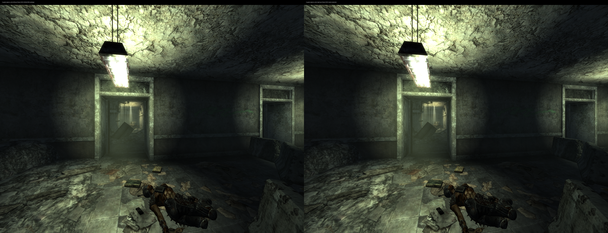
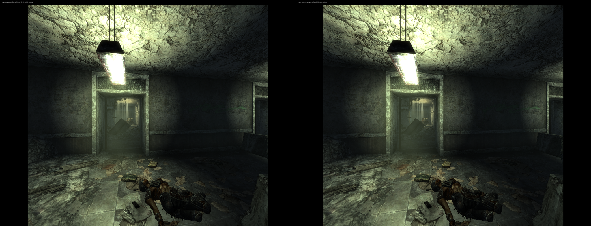

# Author's DLSS path: full-size shared output on Proton

The author's bundled Vulkan renderer and **64-bit D3D11 NGX DLSS helper** now
produce fresh stereo images in the isolated TTWVR 1.1.3 test. This repairs the
stale output described in the [earlier retest](bundled-renderer-113.md).
It is separate from our addon's D3D12 Super Resolution backend. DLSS itself is
still evaluated through the author's D3D11 helper, not a new Vulkan NGX port.
[D3D11 DLSS is supported by DXVK-NVAPI](https://github.com/jp7677/dxvk-nvapi#readme).

The regular Fluorine installation and Steam command remain unchanged. These
are simulated-Monado results, not WiVRn streaming or physical-headset validation.
NR, DLAA, our addon's SR and frame generation are disabled in these tests.

## Diagnosis

The original route advertised direct headset-image output, then allocated
**16×16 fallback output textures**. The helper had zero imported headset images
and output generation zero. Its fallback render-target views referenced those tiny textures instead of a
usable full-size output.

The author's diagnostic dump helped separate the stages:

- Shared scene color, depth and motion-vector inputs changed with head movement.
- The actual per-eye NGX output was 1380×1380 for the tested Quality crop and
  changed across frames and head movement. NGX evaluation returned `0x1`
  (success), alternating feature IDs 3, 4, 3, 4.
- The dump's ordinary `out.raw` was a separate 16×16 black fallback texture.
  Reading the exact texture passed as NGX's Output parameter established that
  DLSS evaluation itself was working.
- The final eye captures and desktop mirror stayed frozen. A helper readback
  temporarily advanced the displayed image once; consecutive frames then froze
  again. Those diagnostic runs are **not** accepted as working output or timing.

Both the original renderer/loader candidate and the native-FSR candidate showed
this mismatch. Removing native FSR was not the fix.

## Patch

At RVA `0x520c82` (file offset `0x520082`), change the indirect capability getter
call `ff d0` to `31 c0` (`xor eax,eax`). The existing store then records that
direct headset output is unavailable. The author allocates **full-size shared
output**, and its ordinary output-copy path delivers the reconstructed eyes.
The Vulkan worker handoff, DLSS evaluation and GPU fences remain enabled.
No CPU image transfer is added to the normal rendering path.

This two-byte instruction has no relocation. The absolute-address flag store
and its relocation remain intact. An earlier experimental edit removed that
store, failed during ASLR relocation, and was discarded. It is not shipped.

This is a conservative exact-build fallback for the tested Proton bridge.
A source-level implementation should use direct output only after all headset
images have been successfully exported, published and imported. The author's
renderer/helper source was not included in the supplied archive.

The previous bundled-DXVK activation and Wine loader fix are still needed,
along with the private [opaque-fence DXVK patch](native-vulkan-fsr.md#shared-fence-scope).
Installed Wine stays unmodified. That fence patch remains specific to this
bridge's increasing timeline values; it does not implement arbitrary D3D fence
rewinds.

## Build a candidate without installing

Use the exact original `TTWVR.dll` from your own `TTWVR1.1.3.zip`:

```sh
python3 tools/experimental_author_dlss.py original/TTWVR.dll test/TTWVR.dll
python3 tools/experimental_opaque_fences.py dxvk-pool32/d3d11.dll test/d3d11.dll
```

For one plugin supporting both this DLSS repair and the embedded Vulkan FSR
repair, add `--native-fsr` to the first command. Both variants reject unknown
or already-patched inputs and refuse existing output files. No game, mod,
NVIDIA or AMD DLL is distributed by this repository.

Follow the [isolated renderer setup](native-vulkan-fsr.md#reproduce-without-installing).
Use the new plugin in that instance and the private DXVK directory. Keep the
supplied author helper and `nvngx_dlss.dll`; no NVIDIA runtime replacement was
needed. Select **Upscaler=DLSS**, a preset, and **Resolution=100%** for the tested
2944×2208 output. The native fallback's 150% setting is not interchangeable.
The earlier experiment used `Off`, which also selected DLSS in this author build;
do not use it as a native control.

Disable the separate addon's NR/DLAA/SR/FG processing. The test layer only
captures submitted images. Its `capture_only` metadata describes the layer,
while TTWVR performs DLSS before that capture point.

The read-only inspector now recognizes both candidates and exposes
`direct_output_capability` and `direct_output_active`; both should be false.
Require successful evaluations **and** fresh pixels in both eyes, including
consecutive frames and actual movement. Posted/shown counters alone are not
proof of valid output.

```sh
python3 tools/inspect_ttwvr_upscaler.py <FalloutNV-Linux-PID>
```

## Validation and performance

Quality, Balanced and Performance pass consecutive-frame and 0.6 m simulated
head-translation checks in both eyes, including the reconstructed center.
Tests use the same copied corridor save and pose. All submit **2944×2208 per eye**.
The combined plugin also passes the native Vulkan FSR regression check.

The first adaptive-pacing Quality sample measured **59.53 app FPS / 86.82 W**.
A combined-patch Balanced startup instead reported a 22.222 ms display period
and measured **30.34 FPS / 68.60 W**. Temporarily disabling the unused FSR
availability flag did not remove this lower rate (**32.63 FPS / 70.07 W**).
These runs are recorded separately, not used as a preset ranking.

For the controlled comparison, the same simulated runtime uses
`XRT_COMPOSITOR_NULL_FPS=90` and `U_PACING_APP_USE_MIN_FRAME_PERIOD=1`.
This holds the reported frame interval at 11.111 ms rather than allowing
Monado to divide it automatically. It does not force the application to render
90 FPS or change WiVRn's default configuration. Each cold launch has 5 seconds
settling before a clean 30-second window, with captures/debugging outside timing.

| Path | Scene input per eye | App submissions/s | GPU power | GPU utilization |
|---|---|---:|---:|---:|
| Original plugin, native fallback | 2944×2208 | 52.08 | 101.89 W | 46.0% |
| Author DLSS Quality | 1984×1488 | 67.43 | 94.23 W | 15.9% |
| Author DLSS Balanced | 1728×1296 | 62.07 | 88.76 W | 14.2% |
| Author DLSS Performance | 1472×1104 | 57.20 | 86.33 W | 13.1% |
| Combined patch, Vulkan FSR Quality | 1984×1488 | 56.64 | 88.93 W | 12.4% |

These are individual local samples, not averages over repeated launches.
Lower input resolution did not give a consistent FPS ordering in these samples;
that is consistent with a scheduling or CPU limit rather than a purely GPU-bound
workload, but no profiler result establishes the cause. GPU utilization and
power are reported with application rate.





[Balanced](evidence/author-dlss-balanced-stereo.png) ·
[Performance](evidence/author-dlss-performance-stereo.png) ·
[Exact hashes, counters, timing and motion evidence](evidence/author-dlss-20261112.json).

The game/helper were closed and all **9 private baseline files** restored.
All **65 monitored regular-install files** and installed Wine matched their
pre-test hashes. Titanfall and WiVRn's default runtime were preserved.


The author's renderer reconstructs a central crop and composites the periphery.
This differs from our full-frame D3D12 helper. The author captures also have
black side margins that are absent from the native control. Whether those lie
outside the visible lens area needs physical-headset verification. Equal
submitted dimensions do not establish equal field of view, rendering workload
or image quality. Nominal runtime refresh
is not application FPS, and none of these numbers represent generated frames.

Check physical-headset motion, temporal ghosting, eye agreement, fog, particles,
Pip-Boy text, peripheral transitions and long-session stability before using
this as a regular-launch replacement. This work does not fix the separate DLAA
haze report or validate frame generation on the author's path.

## Exact candidates

| File | SHA-256 |
|---|---|
| Original TTWVR 1.1.3 plugin | `4c45d6e5adb5da76dd3d08bf0639d360761d3dc50d891ea0bd19b51e4fb006a0` |
| Author DLSS candidate | `8384261c4b5fafd90a7fe860ccb7e1e24953a653c2fdbeafb8bd46ab34485f64` |
| Combined author DLSS + native FSR candidate | `ee9e2e1b1d2ae120244ca53f033327ee8bad83fb43a7ffa1b79753c17e50270f` |
| Private opaque-fence D3D11 | `09e23a2003e03d616858e0c2ded02456b4908b3e17fb66f760ff507ec38e753c` |

The minimal candidate changes 22 bytes including the earlier renderer/loader
fixes; the combined candidate changes 356. The helper and NVIDIA runtime remain
original. The combined plugin reports multiplayer build `0EB366D1`, versus
`3CDD4003` for the original. Compatibility with unpatched players is not established.
