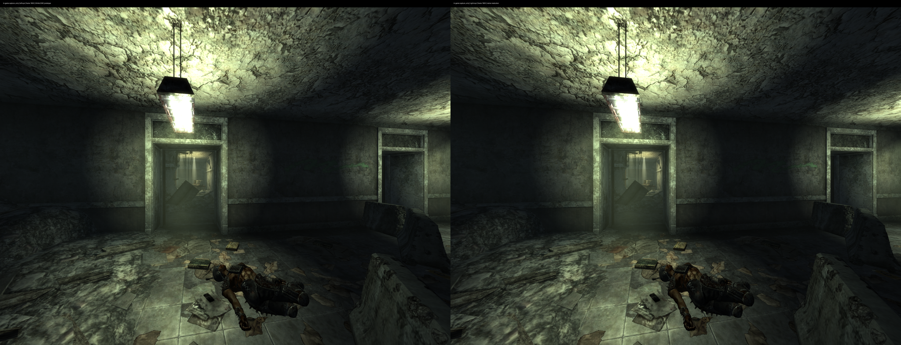
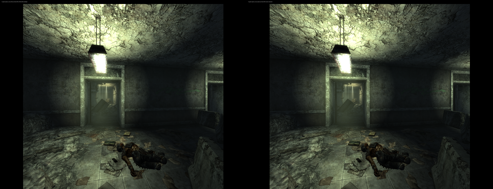

# Author's native Vulkan FSR path on Proton

For the current installation, use the [prepared-install tool](installation.md).
It includes this repair together with author DLSS and the required Linux
companions. Both exact 1.1.3 and [1.1.4](ttwvr-1.1.4.md) builds are supported.
The detailed experiments below record the 1.1.3 diagnosis and validation.

The TTWVR 1.1.3 renderer now reaches **embedded FSR 3.1.4 in the 32-bit game**,
using the author's bundled custom DXVK and per-eye Vulkan contexts. Complete
stereo images and movement in the reconstructed center have been captured.
This is separate from [our D3D12 helper's FSR 3.1.5 path](../archive/rendering-addon/docs/fsr-integration.md).

This remains an **isolated experiment**, not a normal-launch replacement.
The regular Fluorine installation, Steam command, Titanfall installation and
WiVRn runtime registration are preserved. No physical-headset validation of
these new patches is claimed. Frame generation and our NR/DLAA/SR processing
are disabled during these tests.

**Later DLSS follow-up:** the [full-size shared-output repair](author-dlss.md)
resolves the frozen DLSS result recorded below. An optional combined candidate
retains these native-FSR repairs. The earlier FSR measurements remain unchanged.

## Repairs

The supplied archive is named `TTWVR1.1.3.zip`; the original plugin identifies
itself as 1.1.2. Only its exact SHA-256 is accepted by the patch generator.

1. Retain the earlier bundled-DXVK activation and `winevulkan.dll` lookup fix.
2. Call the embedded FSR initializer at RVA `0x550210` during renderer startup,
   save its success flag, and retain the original postprocess initializer.
   The released plugin contains the native FSR implementation but does not
   call that initializer or enable the native path at this startup site.
3. Preserve **64-bit Vulkan handles** through the 32-bit FidelityFX abstractions.
   This covers external and returned `VkImage` resources, `VkPipeline` creation,
   binding and destruction, and uniform-buffer allocation/descriptor binding.
   Losing the upper DWORD first caused an NVIDIA image-view crash; after that
   was repaired, missing pipeline/constant-buffer handles left the central FSR
   region black while the surrounding image continued to update.
4. In the launch-scoped 32-bit DXVK copy, export shared D3D11 fences using
   `OPAQUE_WIN32_BIT` instead of `D3D11_FENCE_BIT`. Native Vulkan timeline
   waits/signals remain active. The original Wine library and 64-bit helper
   stay unchanged. This avoids exporting Wine's process-local fence-rewind
   metadata to the other process.

The native-FSR patch changes 354 bytes in the exact TTWVR DLL, including code
inserted into checked padding. Calls/jumps are relative and startup uses
call/pop addressing, retaining ASLR. Unused release-build resource/pipeline
name tails hold a marker and the high DWORD; unmarked records retain the
original conversion. Leading names, descriptions, state and structure sizes
are preserved. This is an exact-build compatibility patch, not a portable
replacement for fixing the author's source types.

The Vulkan handle diagnosis was checked against AMD's
[SDK v1.1.4 Vulkan backend](https://github.com/GPUOpen-LibrariesAndSDKs/FidelityFX-SDK/blob/v1.1.4/sdk/src/backends/vk/ffx_vk.cpp)
and [host types](https://github.com/GPUOpen-LibrariesAndSDKs/FidelityFX-SDK/blob/v1.1.4/sdk/include/FidelityFX/host/ffx_types.h),
then against the supplied plugin's actual instructions and layouts. No SDK
source, game/mod DLL, or NVIDIA runtime is redistributed by this patch.

## Shared-fence scope

This is **only for the tested TTWVR bridge and increasing timeline values**.
D3D fences can rewind; opaque Vulkan timelines cannot implement that general
contract. Do not apply this DXVK change to arbitrary games or all Proton
launches. The earlier diagnostic `win32u.so` patch is no longer required for
this candidate.

The [equivalent DXVK source patch](../patches/dxvk-ttwvr-opaque-fences.patch)
applies to the [existing pool build](dxvk-pools.md)'s pinned revision. The
one-byte [guarded patch generator](../tools/experimental_opaque_fences.py)
reproduces the tested 32-bit DLL without rebuilding or touching installed Wine.

The standalone [shared-fence probe](../tests/shared_fence_probe.cpp) now accepts
an optional round count. With the private DXVK copy and stock Wine, **64
32-bit-parent/64-bit-child GPU round trips passed**, advancing from 7 to 515.
Both sides issue actual GPU waits/signals and check completed values; the
child exits zero. This does not prove arbitrary rewinds or all application
lifetime cases. A live Quality-to-Performance change also recreated FSR
resources without the previous pipeline-destruction failure.

A software-breakpoint attempt inside the 32-bit D3D11 signal method caused a
Wine/WoW64 debug exception and was abandoned. It is not treated as a valid
application fence trace or included in timing results.

## Reproduce without installing

Close the test game/helper first. Keep originals and create new files:

```sh
python3 tools/experimental_native_fsr.py /path/to/original/TTWVR.dll /path/to/test/TTWVR.dll
python3 tools/experimental_opaque_fences.py /path/to/dxvk-pool32/d3d11.dll /path/to/test/d3d11.dll
```

Both tools reject unknown input hashes and existing output files. They only
create candidate files; they do not install, change the registry, launch a
game, or modify a running process. The first script includes the earlier
bundled-renderer/loader changes, so give it the original plugin, not an
already-patched DLL. The second expects the exact pool-build D3D11 DLL.

Use a separate game/mod instance and a private renderer directory containing
the pool build's `d3d9.dll`, `dxgi.dll`, the new `d3d11.dll`, and a matching
`hashes.json`. The existing [launch-scoped DXVK overlay](dxvk-pools.md#launch-isolation)
lets Proton populate a private `syswow64` directory without overwriting
installed libraries. Use the patched TTWVR plugin only in that test instance.
Keep its bundled `ttwvr_dxvk_d3d9.dll` and `ttwvr_dlss_host.exe` from your own
archive. The helper still starts even when native FSR does the reconstruction.

Disable our addon's NR, DLAA, FSR, DLSS and FG processing. A passive capture
layer was used for validation; the original author controls were exposed.
Select `Upscaler=FSR` and the desired `Upscaler Level` in the author's settings.
At **Resolution=100%**, the tested OpenXR output is **2944×2208 per eye**.
The old fallback's 150% setting is not interchangeable: this author's path
produces a larger target at 150%.

`NVVR_FSR_32BIT=1` selects full-precision shader arithmetic; it does **not** mean
32-bit process support. Both full-precision and normal half-precision startup
were tested after the handle fixes. The handle repair is required either way.

Do not assume the helper status text proves which path rendered the eyes.
It can still say `DLSS` while native FSR is processing. Use the extended
[read-only inspector](../tools/inspect_ttwvr_upscaler.py), then capture pixels:

```sh
python3 tools/inspect_ttwvr_upscaler.py <FalloutNV-Linux-PID>
```

Require `native_fsr_active`, no failure flag, advancing native frame counts,
complete images, both eyes, consecutive frames and actual headset motion.
The counters are non-atomic diagnostic snapshots, not image-validity proof.

## Validation and limits

The simulated Monado runtime exercises GPU rendering without changing WiVRn's
default registration. It does not validate streaming, latency or comfort.
The author reconstructs a central crop and composites peripheral regions;
this is not the same full-frame processing workload as our helper path.
Final submitted dimensions alone do not establish identical image quality.
The native control uses the original plugin/fallback and its 150% setting; the
author FSR candidate uses 100%, with the same 2944×2208 submitted dimensions.

After the complete handle fix, the center became nonblack in both eyes.
For a 0.6 m simulated headset translation, about **99.9% of central pixels**
changed in each eye, including on reversal; consecutive frames also differed.
Before the constant-buffer repair, the central region stayed black despite
advancing native dispatch counters and moving peripheral imagery.

Fresh launches of the same saved corridor and simulated pose gave these clean
30-second samples, with stock Wine and no capture, debugger or compilation
running during the timing windows:

| Path | Scene input per eye | App submissions/s | GPU power | GPU utilization |
|---|---|---:|---:|---:|
| Original plugin, native fallback | 2944×2208 | 39.75 | 94.76 W | 33.4% |
| Author Vulkan FSR Quality | 1984×1488 | 52.50 | 81.71 W | 12.3% |
| Author Vulkan FSR Balanced | 1728×1296 | 61.66 | 90.19 W | 13.4% |

All submit 2944×2208 per eye. These are individual local samples, not a headset
performance forecast or proof of equal image quality. Monado's adaptive pacing
contributes to the rates. The author renderer/worker, cropped processing and
reconstruction change together; this does not isolate an FSR-only benefit.
Performance (1472×1104 input) rendered after a live switch, but its timing is
not included in this matched table.





[Balanced stereo capture](evidence/native-vulkan-fsr-balanced-stereo.png).

The image labels describe the passive capture layer as `capture_only`/bypass;
the second image's reconstruction is performed by TTWVR's verified native FSR
backend, outside that layer.

The first full-precision Quality sample measured **50.62 app submissions/s**
and **85.19 W** on RTX 5090 / simulated Monado at 90 Hz. It still used the
broader diagnostic Wine overlay. The final stock-Wine comparisons and exact
hashes are recorded in [machine-readable evidence](evidence/native-vulkan-fsr-20261112.json).
These are application submission rates, not headset refresh or generated FPS.

A live Performance sample measured 42.52 submissions/s and 74.64 W, but its
viewpoint shifted after opening the VR menu and avatar geometry intruded.
It is excluded from matched performance comparisons. Captures, GDB work,
compilation and image conversion are kept outside clean timing windows.

Physical-headset motion, long sessions, outdoor scenes, fog, particles,
Pip-Boy text, temporal ghosting and peripheral transition quality remain to be
checked. This does not fix the separate reported DLAA haze or establish that
the author's DLSS path now produces fresh images. The final opaque-fence DLSS
check still changed **zero pixels in both eyes**, across consecutive frames
and a 0.6 m head translation. `Upscaler=Off` selected DLSS in this build, so it
must not be used as a native control. No new FG claim is made.

The modified plugin reports build ID `81CFA33D`; the original reports
`3CDD4003`. TTWVR requires matching builds for multiplayer, so interoperability
with unpatched players is not established.

The test game was closed. Six private runtime/configuration files and the
private D3D11 cache were restored; all **65 monitored regular-install files**
and the installed Wine library matched their pre-test hashes. The regular
Steam command and WiVRn registration are unchanged.

## Exact tested candidates

| File | SHA-256 |
|---|---|
| Original TTWVR plugin | `4c45d6e5adb5da76dd3d08bf0639d360761d3dc50d891ea0bd19b51e4fb006a0` |
| Native FSR candidate | `f8a8eb95070eaaee0041fd8901f69e1150abea3cf8115ac7206c24a153c2dedf` |
| Pool D3D11 input | `857f0d0444914dd157b19769a4f4a55f24f53f68eeb249cc9b085b906684e889` |
| Opaque-fence D3D11 candidate | `09e23a2003e03d616858e0c2ded02456b4908b3e17fb66f760ff507ec38e753c` |
| Unmodified Wine `win32u.so` | `d2f34ac08f9768a75457957b28a50c4f517cb919489f02f9e07e364c7ec8a75c` |
