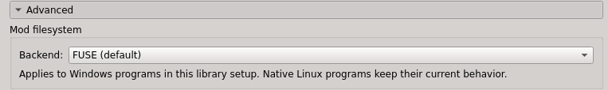
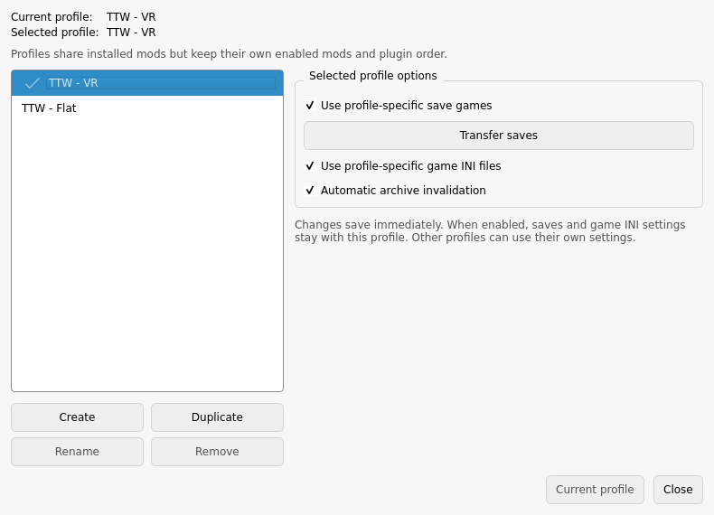

# Prepare TTW in native Fluorine

[← Installation](installation.md) · [Downloads and packages](requirements.md)

**Goal:** a working flat TTW game, plus a separate VR profile ready for the patch tool.

Already have that in Fluorine? Go to [Apply the Linux patch](installation.md). Existing folder layouts are supported through [configuration overrides](configuration.md).

## 1. Download the requirements

Use the [download table](requirements.md#games-and-mods). Install the listed [Linux packages](requirements.md#linux-packages) too.

1. Install the English Steam versions of both Fallout games and all DLC.
2. Start New Vegas from Steam once, reach the main menu, then quit. This creates its Windows environment, called a **Proton prefix**.
3. Download the mods and tools into a folder you can find again.
4. Install WiVRn and connect the headset once before proceeding.

**Ready when:** vanilla New Vegas starts, and WiVRn can connect to the headset.

## 2. Make a dedicated workspace

The guide uses this layout:

```text
~/Games/ttwvr/
├── apps/fluorine-manager/   extracted native manager
├── game/                   independent New Vegas copy
├── compat/pfx/             copied Proton prefix
├── config/                 Fluorine settings
├── share/                  Fluorine application data
├── instance/               mods and profiles
└── linux-fixes/             created later by the patch tool
```

In a terminal, set the workspace once. Keep this terminal open for the commands below:

```sh
ttwvr_root="$HOME/Games/ttwvr"
mkdir -p "$ttwvr_root/apps" "$ttwvr_root/config" "$ttwvr_root/share"
```

1. In Steam, right-click **Fallout: New Vegas → Properties → Installed Files → Browse**.
2. Copy the whole **Fallout New Vegas** folder into the workspace and name the copy **game**.
3. From the game's Steam library, copy **steamapps/compatdata/22380** into the workspace and name the copy **compat**.
4. Extract the Fluorine archive into **apps**, so its launcher is **apps/fluorine-manager/fluorine-manager**.
5. Extract the [supported Proton archive](requirements.md#proton) into Steam's **compatibilitytools.d** directory.

Use independent file copies or reflinks, not hardlinks. Keep mod assets as real files: Fluorine 0.4.1 skips symlinked assets.

**Ready when:** these files exist:

- `game/FalloutNV.exe`
- `compat/pfx/system.reg`
- `apps/fluorine-manager/fluorine-manager`
- A `proton` executable inside the extracted Proton directory.

The copy steps above assume fresh `game` and `compat` destinations. If they already exist, use your prepared copies rather than nesting another copy inside them.

## 3. Create and open the native instance

Download this repository inside the workspace:

```sh
git clone https://github.com/ethanfel/ttwvr-linux.git "$ttwvr_root/ttwvr-linux"
cd "$ttwvr_root/ttwvr-linux"
```

Set the Proton path to the folder you extracted. This example uses Steam's default location:

```sh
ttwvr_proton="$HOME/.local/share/Steam/compatibilitytools.d/proton-cachyos-wineopenxr-fix"
```

Create the instance once:

```sh
env XDG_CONFIG_HOME="$ttwvr_root/config" \
    XDG_DATA_HOME="$ttwvr_root/share" \
    "$ttwvr_root/apps/fluorine-manager/fluorine-manager" create-portable \
    --name instance --output "$ttwvr_root" \
    --game TTW --game-path "$ttwvr_root/game" \
    --prefix "$ttwvr_root/compat/pfx" --proton "$ttwvr_proton"
```

Open it through the project launcher:

```sh
python3 tools/launch_fluorine.py \
  --manager "$ttwvr_root/apps/fluorine-manager/fluorine-manager" \
  --instance "$ttwvr_root/instance" \
  --config-home "$ttwvr_root/config" \
  --data-home "$ttwvr_root/share" \
  --manager-only --profile Default
```

Use this command to reopen the manager during preparation. It keeps settings and saves attached to this workspace.

Press **Ctrl+S** to open Fluorine settings, then select **Compatibility**. Check these values:

| Where | Value |
|---|---|
| Managed game | **TTW**, with the workspace's **game** folder. |
| Settings → Compatibility → Proton | The supported build you extracted. |
| Prefix folder | The workspace's **compat/pfx**, including the final `pfx`. |
| Settings → Compatibility → Advanced → Mod filesystem | **FUSE**. Leave experimental filesystem options at their defaults. |



If first-run setup offers a different prefix, select your prepared copy. The instance and dedicated global settings must use the same Proton and prefix; [the reference](native-fluorine.md#instance-layout-and-configuration) shows where these are stored. Click **Save** when the settings are correct.

**Ready when:** the manager opens the intended instance without a missing-game-plugin error. Some native dialogs still say “ModOrganizer”; that is normal.

## 4. Convert TTW

Close Fluorine during conversion. Open **mpi_installer_gui** from the native TTW converter download. If Linux blocks execution, enable **Is executable / Allow executing** in the file's properties.

Fill in these fields:

| Converter field | Select |
|---|---|
| Fallout 3 | Your Steam **Fallout 3 goty** installation. |
| Fallout New Vegas | The workspace's **game** folder. |
| MPI Package | The `.mpi` file inside the extracted TTW installer package. |
| Output Directory | **instance/mods/Tale of Two Wastelands** inside the workspace. |

1. Click **Start Installation** and let conversion finish.
2. Check the converter's log for failures before continuing.
3. Reopen Fluorine with the command above.
4. Enable **Tale of Two Wastelands** in its mod list.
5. Install and enable **YUPTTW** using the [TTW guide's download](https://thebestoftimes.moddinglinked.com/ttw.html).

**Ready when:** the TTW mod contains its generated files and appears enabled in Fluorine. The native converter's output size differs from the Windows guide; a size check alone is not enough.

## 5. Add the utilities and patch FalloutNV.exe

Follow [Essential Mods](https://thebestoftimes.moddinglinked.com/essentials.html) for the required downloads and INI presets. Use these Linux equivalents:

| Guide instruction | Do this here |
|---|---|
| Put files in the game's root folder | Use **workspace/game**, beside FalloutNV.exe. |
| Install a mod with the manager | Click Fluorine's **Install Mod** button; choose the downloaded archive, then enable it. |
| Run the Windows 4GB patcher | Use **FNV4GB for Proton**, as below. |
| Edit a profile INI | Use Fluorine's INI editor for the selected profile. |

Do not miss the separate INI downloads for JIP LN, JohnnyGuitar, ShowOff and NVTF. A plugin DLL alone does not complete those guide entries.

Extract **FalloutNVPatcher** from the Proton patcher download into **game**, beside FalloutNV.exe. Then run:

```sh
(cd "$ttwvr_root/game" && chmod +x FalloutNVPatcher && ./FalloutNVPatcher)
```

**Ready when:** the patcher reports success and **FalloutNV_backup.exe** exists. Keep that backup.

## 6. Test a flat profile

1. Click **Profiles** at the top of Fluorine. Select **Default**, click **Duplicate**, and name the copy **TTW - Flat**.
2. Enable **Use profile-specific game INI files**, **Use profile-specific save games** and **Automatic archive invalidation** for it.
3. Enable TTW, YUPTTW and the required utilities in this profile. Apply the guide's INI settings here.
4. Press **Ctrl+E** to open Fluorine's executable editor and configure:

| Field | Value |
|---|---|
| Title | **Tale of Two Wastelands** |
| Binary | **workspace/game/FalloutNV.exe** |
| Start in / working directory | **workspace/game** |
| Run with Proton | Enabled |
| Use Steam integration | Enabled |
| Override Steam AppID | **22380** |

5. Install and enable **ML Utilities Checker** from the [guide's testing section](https://thebestoftimes.moddinglinked.com/essentials.html#testing-utilities).
6. Select **Tale of Two Wastelands** in the executable list and click **Run**.
7. Wait for **All utilities installed!** at the main menu. Resolve any named missing utility before continuing.
8. Start a game, reach the intro, save, and reload that save.
9. Quit Fallout and disable the checker in Fluorine.

**Ready when:** the utilities pass and a save reloads. The Linux patch check later does not replace this game test.

## 7. Prepare the VR profile

1. Click **Profiles** at the top of Fluorine. Select **TTW - Flat**, click **Duplicate**, and name the copy **TTW - VR**.
2. Select **TTW - VR**.
3. Install the complete original **TTWVR 1.1.4** archive as its own mod. Keep its helper files and runtimes together.
4. Enable that mod only in **TTW - VR**. Exactly one original TTWVR mod should be enabled there.
5. Close Fluorine.

The profile dialog should now contain both profiles, with saves and INIs kept per profile:



**Ready when:** the VR mod has **NVSE/Plugins/TTWVR.dll** directly below its installed mod folder, and TTWVR remains disabled in **TTW - Flat**.

Continue at [installation step 1](installation.md#1-download-the-patch-tool). You already cloned the repository, so just enter its directory and copy the setup template.

The fresh-instance CLI above was checked against Fluorine 0.4.1 source. Published gameplay validation used a migrated native instance; a complete fresh installation on another distribution remains a separate check. [Validation record](setup-validation.md).
