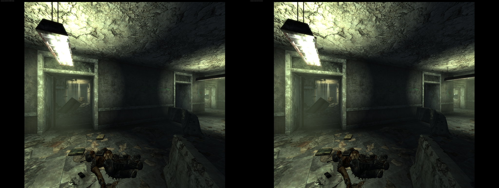
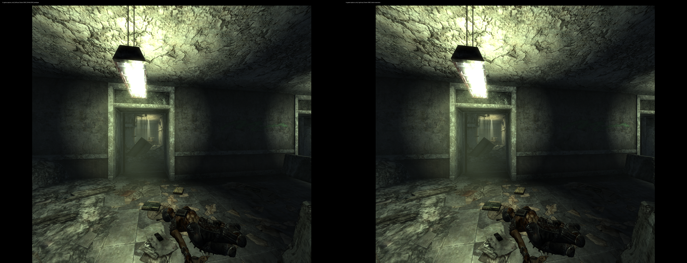

# TTWVR 1.1.4 author-renderer port

The [Linux patch tool](installation.md) supports the supplied **TTWVR1.1.4.zip**
and retains exact-build support for 1.1.3. It uses the original VR menu and
renderer, with author D3D11-helper DLSS and native Vulkan FSR. The custom
D3D12 rendering addon is archived.

## Changes in the supplied archive

The archive contains the same 767 files as 1.1.3; four changed: TTWVR.dll,
TTWVR.ini, ttwvr_dlss_host.exe and ttwvr_voice_host.exe. The helper executable
code sections are unchanged; differences are headers/read-only data. The
bundled renderer and NVIDIA DLSS runtime are unchanged.

New INI keys are **Turn Speed=50** and **Loot Menu=Both**. The local upgrade
preserved existing resolution, upscaler, sharpness, calibration, profile INIs
and saves. The setup tool preserves the already prepared mod's complete INI.
Archive metadata/runtime labels still contain 1.1.2, so support is identified
by hashes, not that label.

## Patch audit

| Patch | 1.1.4 location |
|---|---|
| Bundled renderer activation | RVA `0x526d8c`, file `0x52618c` |
| Wine Vulkan loader string | File `0xa51fd0` |
| Shared DLSS output capability | RVA `0x532ee2`, file `0x5322e2` |
| Embedded FSR initialization hook | RVA `0x53329b` |
| FSR startup trampoline | RVA `0x567760` |

Instruction bytes, branch/call destinations, padding, status fields and
relocation overlap were reviewed against this build. No patched range overlaps
a relocation entry. The shared-output patch preserves the later flag store.
FSR pointer/handle repairs retain the high DWORD of Vulkan handles. All tools
pin both the original input and resulting output hashes and reject unknown or
already modified originals. The older 1.1.3 output hashes remain unchanged.

| File / candidate | SHA-256 |
|---|---|
| Original ZIP | `5a48c134222d334b37519bca93473c4566e1bd5349dd46fa1f18153578859ed1` |
| Original TTWVR.dll | `7eb72860d209d9b9bdd774607220ee63323367aa9fa525f6eb1b23184f30f91e` |
| Author DLSS only, 22 changed bytes | `d35cc677ea792bbfbb21936656cfdb2d4bc023a1a4e757b79eb8cb31a2e00616` |
| Native FSR only, 354 changed bytes | `216e74fae62df07f7b1cea9857097288f1d946b510b5d6bb26effb368efcf127` |
| Combined DLSS + FSR, 356 changed bytes | `e54dccb5e29e1361d36dd9f9a7ee23294b07663f29690cabbaff7168cbd62413` |

The setup tool uses the combined candidate plus the scoped DXVK fence fix.
No patched mod binary is distributed.

## GPU validation

Isolated Monado simulated-headset runs used the same saved corridor and the
combined plugin, with the new helpers. Custom NR/DLAA/SR/FG were disabled;
a passive layer captured submitted images. The game menu was passed before
collecting gameplay evidence.

| Mode | Scene input → per-eye output | Frames checked |
|---|---|---|
| DLSS Quality, 200% | 2944×2208 → 5888×4416 | 2730/2731 and translated 2940/2941 |
| Native Vulkan FSR Quality, 100% | 1984×1488 → 2944×2208 | 2580/2581 and translated 2760/2761 |

Both eyes changed on consecutive frames and after head translation, including
the reconstructed center. DLSS calls alternated features **3,4,3,4**, each
returning **0x1 (success)**. FSR reported active/initialized/enabled, with no
failure or copy-refusal flag. Stereo previews were inspected for complete,
matching eyes. Existing black side margins remained.

[Machine-readable validation](evidence/ttwvr114-20261112.json).
These tests establish functional rendering, not a 1.1.3-versus-1.1.4 benchmark,
WiVRn streaming quality or headset comfort. Physical 1.1.4 confirmation and
exhaustive testing of the new menu options remain pending.

All 13 private test baseline files were restored after validation; 65 checked
regular-install files remained unchanged. The separate local headset instance
was then upgraded, preserving 56 checked profile/save/settings files and the
old disabled 1.1.3 mod. Its existing launcher remains valid.
