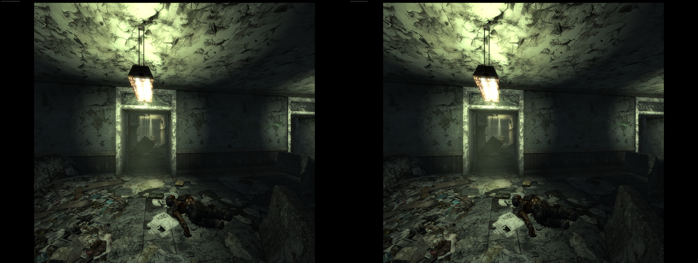
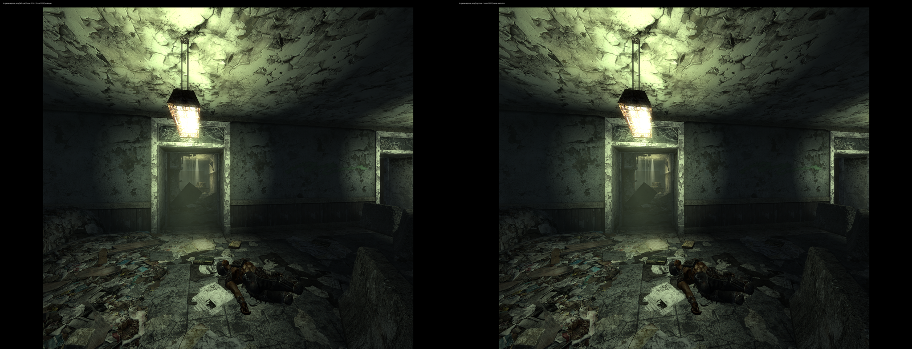

# TTWVR 1.1.5 author-renderer port

The Linux patch tool supports the supplied **TTWVR1.1.5.zip**, retaining exact-build
support for 1.1.4 and 1.1.3. Use the [existing-install update procedure](maintenance.md#update-an-existing-installation);
install the complete original archive before applying the Linux patch. No patched
TTWVR binary or vendor runtime is redistributed.

## Archive changes

Compared case-insensitively with the full 1.1.4 archive, 777 files replace 767.
Four existing files changed: meta.ini, TTWVR.dll, ttwvr_dlss_host.exe and
ttwvr_voice_host.exe. Ten assets were added: eight numbered holster meshes and
two number textures. There are no removed files. The helper executable code
sections, bundled DXVK, DLSS/FSR runtime libraries and default TTWVR.ini are unchanged.
The plugin now reports 1.1.5 in its startup log.

The local update retains the user's complete VR INI, 200% / DLSS Quality / 100%
sharpness, NMC selection, profile settings, saves and existing Steam command.
The previous 1.1.4 mod stays available, disabled, with a rollback record.

## Patch audit

| Patch | 1.1.5 location |
|---|---|
| Bundled renderer activation | RVA `0x55174c`, file `0x550b4c` |
| Wine Vulkan loader string | File `0xa83870` |
| Shared DLSS output capability | RVA `0x55d872`, file `0x55cc72` |
| Embedded FSR initialization hook | RVA `0x55dc2b` |
| FSR startup trampoline | RVA `0x591eb0` |

Instruction windows, call/branch destinations, padding and resource/status fields
were checked against this build. No modified range overlaps a PE relocation.
The FSR repairs retain the high DWORD of Vulkan handles across the 32-bit ABI.
Both prior versions retain their original output hashes. Unknown or already
modified inputs are rejected. The new helper has its own pinned preflight hash.

| File / candidate | SHA-256 |
|---|---|
| Original ZIP | `5a07642c8ddc7f4f201b727e1c43182739f592936ea409ab693e5baf621e4df3` |
| Original TTWVR.dll | `e14567bc1c7d183130f902f9489b8cffe6269de06eea0d79bf8d1d3098c595b1` |
| DLSS only, 22 changed bytes | `19a09590e5a76ca8d93394180ff320561a7390a292d36b9021dd2184ea12d5d1` |
| Native FSR only, 354 changed bytes | `4c6b2d9cccf0adffd3376a4a7eadffccc5f32c90537922064c35c2bf3c65dfdf` |
| Combined DLSS + FSR, 356 changed bytes | `78dddb7294cca8b21bc9cec6bf8950c956d536946bb9520cca8cbe4b9d48a48a` |

The setup tool uses the combined candidate with the existing DXVK fence repair.
Its real 1.1.5 preflight fixture passed; 44 regression tests passed and one was skipped.

## GPU validation

Tests used an isolated native Fluorine instance, NMC textures, the supported
CachyOS WineOpenXR-fix build and Monado's simulated headset at 90 Hz. Saved
Big Town and Springvale Elementary School scenes were loaded before capture.
Custom NR, DLAA, super resolution and frame generation were disabled in the
passive capture layer; the author's renderer performed the upscaling.

| Mode | Scene input → per-eye output | Checked |
|---|---|---|
| DLSS Quality, 200% | 2944×2208 → 5888×4416 | Both scenes; consecutive stereo and translated-head interior |
| Native Vulkan FSR Quality, 100% | 1984×1488 → 2944×2208 | Interior; consecutive stereo and translated head |

Both eyes were complete and changed on consecutive frames. The reconstructed
center responded to a 20 cm simulated head translation. Capture pairs had matching
display times and view parameters. DLSS evaluations alternated features **3,4,3,4**,
all returning **0x1 (success)**. Native FSR reported initialized/enabled/active,
increasing frame counters and no failure or copy-refusal flag.

## Timing scope

These short fixed-pose samples include CPU/OpenXR spans and whole-GPU telemetry;
they are not GPU execution timings or headset frame-time percentiles. A subsequent
1.1.4 control used the same NMC pack, VR INI and saved scenes. They do not establish
a general performance gain or regression. FSR and DLSS used different output
resolutions and must not be ranked by these FPS values.

| Test | Big Town FPS | School FPS |
|---|---:|---:|
| 1.1.5 DLSS Quality 200% | 59.06 | 43.35 |
| 1.1.4 DLSS Quality 200%, subsequent control | 57.38 | 53.24 |
| 1.1.5 FSR Quality 100% | — | 49.93 |
| 1.1.5 DLSS Quality 200%, interior repeat | — | 53.14 |

The slower first interior sample did not repeat: the later 1.1.5 run measured
53.14 FPS against 53.24 FPS for the 1.1.4 control. One intervening test was
excluded because its profile had both TTWVR versions disabled and produced no
VR frames; correcting the test profile restored normal startup.

[Machine-readable evidence](evidence/ttwvr115-20261114.json).
Physical WiVRn testing of 1.1.5, new holster interaction, multiplayer, all control
combinations and long sessions remain unvalidated by these tests.
