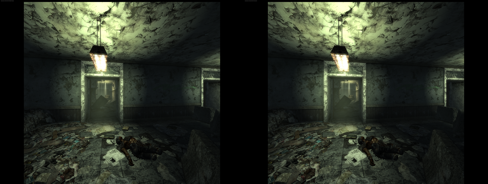
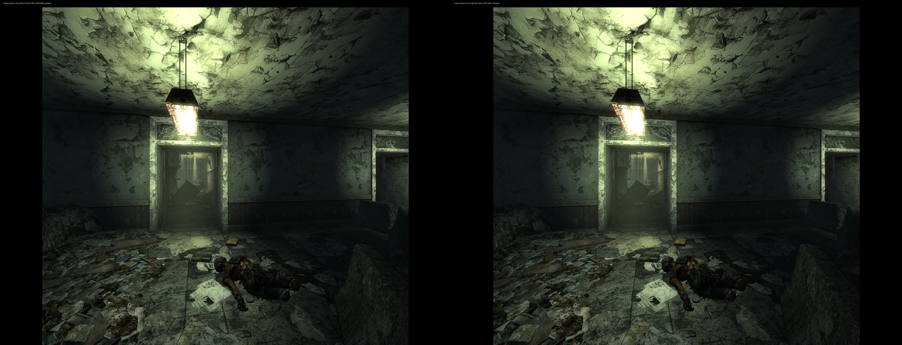

# TTWVR 1.1.6 Linux port

The Linux setup tool supports the exact supplied **TTWVR1.1.6.zip**, alongside
1.1.5, 1.1.4 and 1.1.3. Follow the [update procedure](maintenance.md#update-an-existing-installation):
install the complete original archive, then apply the Linux patch. No TTWVR or
vendor runtime binaries are redistributed.

## Archive and patch audit

The archive contains 777 files. Compared with 1.1.5, five changed: meta.ini,
TTWVR.dll, TTWVR.dat, ttwvr_dlss_host.exe and ttwvr_voice_host.exe. No files were
added or removed. Both helper executable code sections are unchanged; their
read-only data changed. The default VR INI and bundled renderer/upscaler runtimes
are unchanged. This comparison does not establish the author's full feature changelog.

| Patch | 1.1.6 location |
|---|---|
| Bundled renderer activation | RVA `0x58448c`, file `0x58388c` |
| Wine Vulkan loader string | File `0xabaf70` |
| Shared DLSS output capability | RVA `0x5905b2`, file `0x58f9b2` |
| Embedded FSR startup hook | RVA `0x59096b` |
| FSR startup trampoline | RVA `0x5c4bf0` |

Instruction windows, branch destinations, padding and status fields were checked
against this build. The FSR patches preserve 64-bit Vulkan handles across the
32-bit interface. No patched range overlaps a PE relocation. The startup hook
retains the original call via its relocated thunk. Unknown or already patched
inputs are rejected, and all three output hashes for each earlier version remain
unchanged. The new DLSS helper has its own pinned preflight hash.

| File / candidate | SHA-256 |
|---|---|
| Original archive | `3df98feb7d544ebf628be38efc12d6bb798bdf77afd43241b2156f7aebc1fae0` |
| Original TTWVR.dll | `503266c4f4c2350b357c8c15021d8bde28973254745d9302b8e3cfde66489a27` |
| dlss candidate, 22 changed bytes | `67fbe92416420840763c0264d697e42826661f6e77685f28856c633a71766ff9` |
| fsr candidate, 354 changed bytes | `676edd310b3f7f24be0da3b1ff139b98b89ab2a1d3c4b8cb53381f83825d9a6c` |
| combined candidate, 356 changed bytes | `63712922499b2155a3d2c6f54abbdfc1eaf95d08712b937c6276d6a8ae0d774d` |

The installer preflight passed on the original 1.1.6 files. Of 45 existing tests,
44 passed and one opt-in mount test was skipped.

## GPU validation

Tests used a private native Fluorine instance, NMC textures, CachyOS with its
built-in WineOpenXR fix, and Monado's simulated headset at 90 Hz. Saves were
loaded before capture. The author's renderer performed the upscaling; the test
capture layer only recorded submitted images.

| Mode | Scene input → per-eye output | Checked |
|---|---|---|
| DLSS Quality, 200% | 2944×2208 → 5888×4416 | Big Town and school interior; consecutive stereo and translated-head interior |
| Native Vulkan FSR Quality, 100% | 1984×1488 → 2944×2208 | School interior; consecutive stereo and translated head |

Both eyes produced nonblank images on consecutive frames with matching display
times. The scene center responded to a 20 cm simulated head translation. DLSS
feature evaluations alternated **3,4,3,4**, all returning **0x1 (success)**.
Native FSR reported initialized, enabled and active, with advancing frame counts,
no failure and no copy-refusal flag.

## Timing and limits

| Short fixed-pose sample | FPS |
|---|---:|
| 116-dlss-200-bigtown | 55.59 |
| 116-dlss-200-school | 49.19 |
| 116-fsr-100-school | 50.77 |

These are CPU/OpenXR timing samples with whole-GPU telemetry. They do not measure
individual headset frame times or establish a performance change from 1.1.5.
DLSS and FSR use different output sizes here and cannot be ranked by these FPS values.

The local upgrade preserves the existing Steam command, NMC, complete VR INI,
profiles, saves and holster calibration. The previous 1.1.5 mod is retained,
disabled, with rollback backups. The opt-in local holster logger has separately
verified 1.1.6 addresses and retains 1.1.5 support; no holster drift fix is claimed.

[Machine-readable evidence](evidence/ttwvr116-20261115.json).
Physical WiVRn/Quest testing of 1.1.6, controller interactions, multiplayer and
long sessions remain unvalidated by this simulated test.
