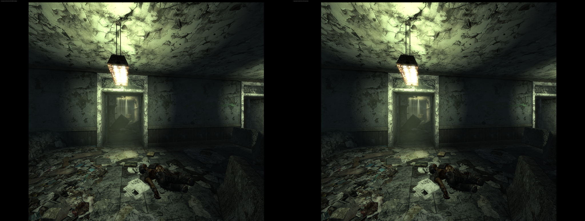
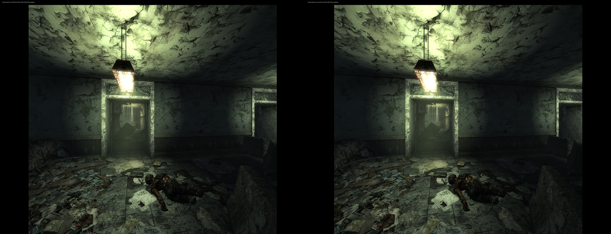

# TTWVR 1.1.7 Linux port

The Linux patch tool supports the exact supplied **TTWVR1.1.7.zip**, retaining
1.1.3 through 1.1.6 support. Install the complete original archive and follow
[the update procedure](maintenance.md#update-an-existing-installation).
No TTWVR or vendor binaries are redistributed.

## Archive and binary audit

The archive contains 777 files. Compared with 1.1.6, four changed: meta.ini,
TTWVR.dll, ttwvr_dlss_host.exe and ttwvr_voice_host.exe. There are no added or
removed files. Both helper executable code sections are identical to 1.1.6;
their read-only data changed. The bundled renderer/upscaler runtimes, TTWVR.dat,
default VR INI and other assets are unchanged. This is a file comparison, not
a reconstruction of the author's full feature changelog.

| Compatibility patch | 1.1.7 location |
|---|---|
| Bundled renderer activation | RVA `0x59ba8c`, file `0x59ae8c` |
| Wine Vulkan module lookup | File `0xad6a00` |
| Shared DLSS output capability | RVA `0x5a79d2`, file `0x5a6dd2` |
| Embedded FSR startup | RVA `0x5a7d8b`, original thunk `0x232a4` → `0x5eb6a0` |
| FSR initialization flag | RVA `0x1b45568` |

Instruction windows, padding, branch destinations and 33 global addresses were
mapped independently against the new binary. FSR's 64-bit Vulkan handle repairs
remain outside PE relocations. The startup trampoline retains the original call.
Exact input/output hashes reject unknown and already-patched DLLs. Patch outputs
for all four earlier releases remain unchanged. The installer also checks the
new DLSS helper hash.

| Input / candidate | SHA-256 |
|---|---|
| Original archive | `1073d23aea2210ad60c0e18964c056db1043ef0a6a87af962eadc80ad13614e0` |
| Original TTWVR.dll | `119a085a5b0101f0618b8e076a421b4b89e30d72d9b6eae874f4e5af7bd3fb27` |
| dlss, 22 changed bytes | `ae2159a0ab9158c90c1016e2c0580c625f28f0c93927ff9a8b7609ec7904164c` |
| fsr, 354 changed bytes | `007ac7d466281a032e6b2ceb475dca361f0a7451539aba782a95540592a289bd` |
| combined, 356 changed bytes | `ae7dc0d7ba94651af0ccd729122f623d3dbdf0b85c6c787838c04bbc721135d6` |

Installer preflight passed. The existing tool suite passed 44 tests, with one
opt-in mount test skipped. The private holster diagnostic passed 12 analyzer
tests and its process-exit/storage-limit fixtures using the new exact layout.

## Saved-game GPU checks

Tests used an isolated native Fluorine instance with NMC and generated TTW LOD,
the supplied CachyOS WineOpenXR-fix Proton, and Monado's simulated headset at
90 Hz. Saves were loaded before capture; the capture layer did not process the
images. The regular installation was activated only after these checks passed.

| Mode | Input → per-eye output | Checks |
|---|---|---|
| DLSS Quality, 200% | 2944×2208 → 5888×4416 | Big Town and school; consecutive stereo, translated-head interior |
| Native Vulkan FSR Quality, 100% | 1984×1488 → 2944×2208 | School; consecutive stereo and translated head |

Both-eye captures have matching display times, consecutive frame IDs and fresh
pixels. A 0.2 m simulated head translation changed both views. Four consecutive
NGX evaluations returned success (`0x1`) while alternating between two distinct
per-eye features. FSR reported initialized/active, advancing frame counters,
no native failure and no refused output copy.

[Machine-readable audit and measurements](evidence/ttwvr117-20261116.json)

Short samples measured 44.8 application FPS outdoors with DLSS 200%, and
51.2 FPS indoors with FSR 100%. These use different scenes and resolutions;
they are **not an upscaler comparison**. CPU OpenXR spans and simulated pacing
are not GPU execution times or physical WiVRn/headset frame-time measurements.

## Installation preservation and limits

The normal Steam command, 200% DLSS Quality/100% sharpness, NMC/LOD, saves,
calibration and VR state were retained. All 777 installed mod files were checked;
125 protected existing files remained byte-identical during activation.
The previous 1.1.6 mod is retained disabled with transactional rollback.
The local read-only holster logger recognizes the verified 1.1.7 layout;
this update does not claim a holster drift correction.

Physical 1.1.7 WiVRn/headset testing, voice recognition, multiplayer, every
controller interaction and long-session behavior still need user validation.
