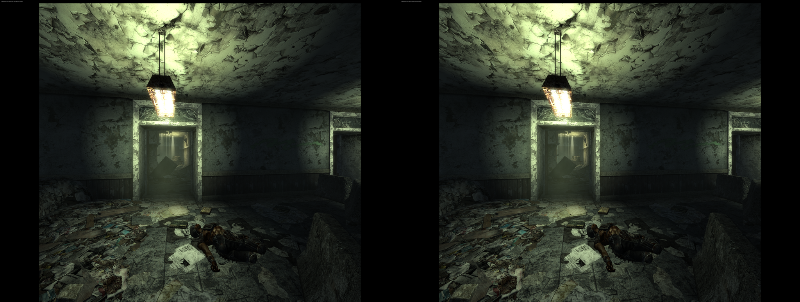
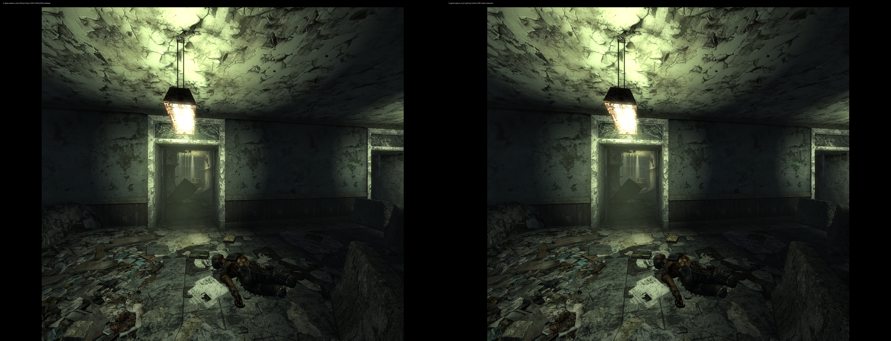

# TTWVR 1.1.8 Linux port

The Linux patch tool supports the exact supplied **TTWVR1.1.8.zip**, retaining
1.1.3 through 1.1.7 support. Install the complete original archive and follow
[the update procedure](maintenance.md#update-an-existing-installation).
No game, TTWVR or vendor binaries are redistributed.

## What changed

The archive contains 777 files: six changed, two were added and two removed.
The plugin, bundled DXVK renderer and DLSS helper contain code changes.
The voice helper's code section is unchanged. The new files are
`ttwvr_rt_host.exe` and `nvngx_dlssd.dll`; two obsolete `fsr_original` DX12 DLLs
were removed. The original INI adds **Ray Tracing=Off**. TTWVR.dat and the
remaining assets are unchanged. This is an archive comparison, not the author's
full feature changelog.

**Ray tracing is not validated by this Linux update. Keep it Off.**
DLSS Super Resolution and native Vulkan FSR are the tested rendering paths.

## Binary audit

| Patch | 1.1.8 location |
|---|---|
| Bundled renderer activation | RVA `0x5bea8c`, file `0x5bde8c` |
| Wine Vulkan module lookup | File `0xcd13e0` |
| Shared DLSS output capability | RVA `0x5cf6b2`, file `0x5ceab2` |
| Embedded FSR startup | RVA `0x5cfa6b`, thunk `0x28137` → `0x61c690` |
| FSR initialization flag | RVA `0x1d5e7d8` |

Instruction windows, branch targets, padding and relocation exclusions were
checked against 1.1.7. The startup trampoline retains the original call.
33 diagnostic globals were mapped independently; unlike earlier releases,
status fields require individual addresses rather than one common shift.
Unknown and already-patched binaries are rejected, and all five earlier patch
outputs remain unchanged. Installer preflight passed with the new renderer
and DLSS helper hashes. The tool suite passed 44 tests, with one opt-in mount
test skipped, including a run against the latest public main checkout.

| Input / candidate | SHA-256 |
|---|---|
| Archive | `9536898464818c4627fbd3cd37365a4f065b49c0e727c5ea342fa1283cc28075` |
| Original TTWVR.dll | `34a4e692927e331e317be993e5a73c17695634a5442e7f85bd9b3ce547c7ff0d` |
| DLSS, 22 changed bytes | `ec33def19bafa1ef753a2a33c2509af9948dfa58952cd79ab81c9cb209c8a40c` |
| FSR, 354 changed bytes | `ec59aa4b8eb143dad7b0950415aa6b94020d66034749141aafc65cd56d370b39` |
| Combined, 356 changed bytes | `5262d92f1e64a5374a702dffd8b779285c49e49091d9582a8fbd5cade3d99805` |

## Saved-game GPU checks

Tests used an isolated native Fluorine profile, CachyOS WineOpenXR-fix Proton,
NMC/generated TTW LOD, copied saves and Monado's simulated headset at 90 Hz.
The capture layer only copied images; neural effects and frame generation
were disabled. Saves were loaded before capture.

| Mode | Input → per-eye output | Scene checks |
|---|---|---|
| DLSS Quality, 200% | 2944×2208 → 5888×4416 | Big Town and school; translated-head school |
| Vulkan FSR Quality, 100% | 1984×1488 → 2944×2208 | School and translated-head school |

Each set contains two consecutive frames from both eyes with matching display
times and fresh pixels. A 0.2 m simulated head translation changed both views.
Four NGX evaluations returned success (`0x1`) on alternating eye features.
FSR reported initialized/active with advancing counters, no native failure
and no refused output copy. The stereo previews were inspected for coherent,
nonblank scenes. These checks are not WiVRn streaming or headset-comfort tests,
and the different resolutions/scenes are not an upscaler performance comparison.

[Machine-readable audit and capture checks](evidence/ttwvr118-20261126.json)

## Settings and addons

Existing settings, NMC/LOD, saves and calibration were preserved during the
local base-mod update; the new Ray Tracing default remains Off. The complete
previous mod is retained disabled for rollback. The Steam launch command is
unchanged.

Addons with version-specific hooks need their own 1.1.8 updates. They were
excluded from renderer validation and not modified by this update. Holster
anchor records grew from 20 to 32 bytes; the local read-only diagnostic was
adapted and checked with 12 analyzer tests, process-exit/storage-limit fixtures
and a live private-game sample. This does not establish that holster drift or
other controller behavior has been fixed.

Physical 1.1.8 WiVRn testing, ray tracing, subtitle behavior, multiplayer, voice
recognition and long-session/controller coverage remain outside this validation.
