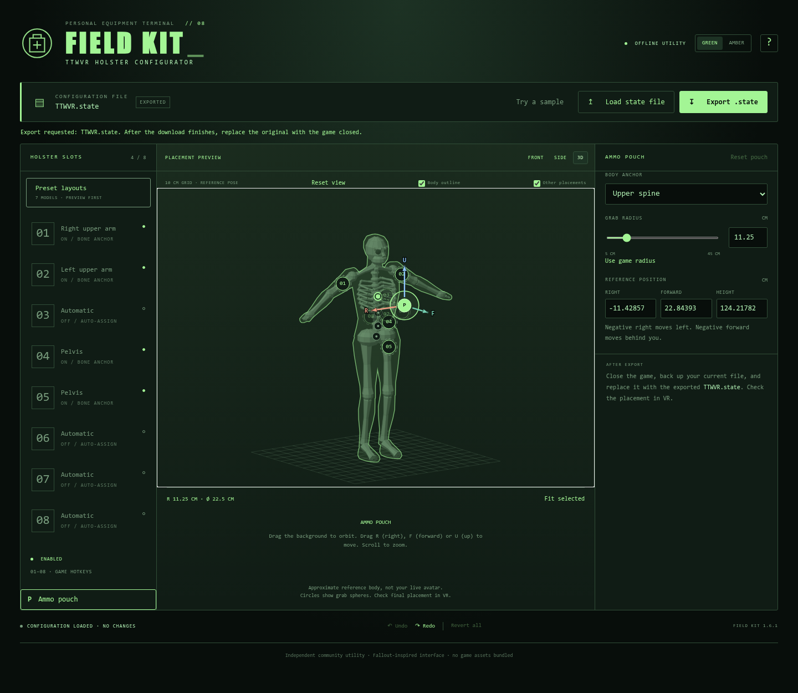
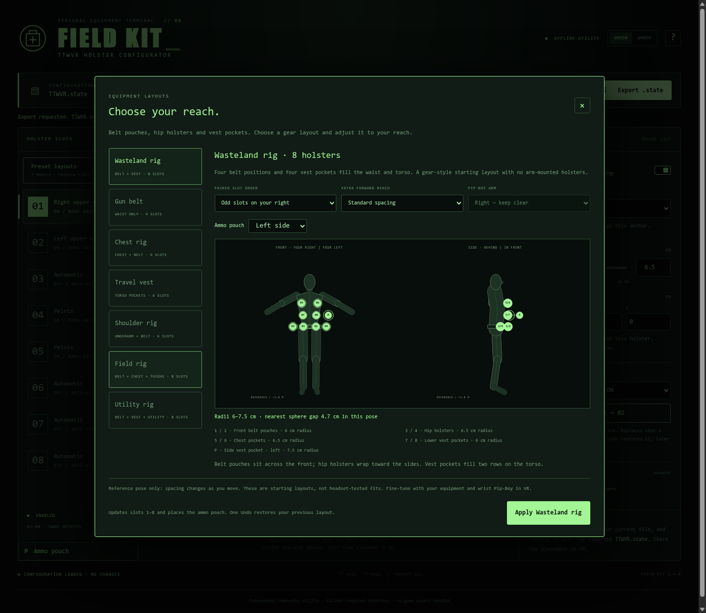

# TTWVR Holster Editor — Field Kit

An offline editor for TTWVR holsters and the ammo pouch.
Open one HTML file in a current browser on **Windows or Linux**. No install,
server, Python, Node, account or network connection is needed to use it.



## Open the tool

Download the [standalone HTML](https://github.com/ethanfel/ttwvr-linux/releases/download/holster-editor-v1.6.1/TTWVR-Holster-Editor.html)
and open it in Edge, Chrome or Firefox. The [portable ZIP](https://github.com/ethanfel/ttwvr-linux/releases/download/holster-editor-v1.6.1/TTWVR-Holster-Editor.zip)
also includes the offline instructions.

1. **Load state file**: select your `TTWVR.state` file, or drop it onto the window.
2. Select a numbered holster. Click a body anchor or choose it from the list.
3. Drag the numbered centre to position it. Drag the square handle on the circle
   to resize its grab sphere. **Front** adjusts left/right and height; **Side**
   adjusts depth and height. Numeric controls use **centimetres**; the file stores metres.
4. To match the other side, choose a destination under **Mirror to another slot**
   and press **Mirror 01 → 02**, for example. The destination is replaced in one
   undoable action. Right upper arm becomes left upper arm with the matching offset.
5. **Export .state** downloads a copy. With Fallout and the mod manager closed,
   back up the original and replace it with the downloaded `TTWVR.state`.
   Remove any browser-added suffix such as `(1)` from the filename.
6. Launch the game and check the placement in VR.

**Try a sample** demonstrates the controls. Load your own file to enable export.
The tool never overwrites game files directly.

## Edit the ammo pouch

Choose **Ammo pouch** below the eight slots. In **3D**, drag the background to orbit the skeleton. Drag the **R**, **F** or **U** arrow to move the pouch right, forward or up. In **Front**, drag **P** for left/right and
height, then in Side for depth. You can also enter centimetres directly.
Under **Body anchor**, choose Body-relative, Pelvis, Lower spine, Middle spine or Upper spine.
You can also click a torso joint on the map. Changing anchors keeps the pouch centre in place in the reference pose. Set **Grab radius**
from 5 to 45 cm, drag the square radius handle, or choose **Use game radius** to inherit TTWVR’s setting.
The editor moves the torso attachment and its fallback together. If your file has
no saved pouch, use **Set initial position** to start at the front of the waist.

## Fix placements from Field Kit 1.1–1.3

**Field Kit 1.4 corrects reversed front/back positioning in the editor.** Earlier
previews and presets could place a sphere behind you while showing it in front.
The forward direction is now checked against skeleton toes and recorded gameplay.

To retain a customized layout, load it in the updated editor, open **Help**, and
choose **Repair old body placement**. It moves body-anchored centres behind the
reference body to the front, preserving their sideways position, height and radius.
This includes pelvis, chest, thigh and shin anchors, even disabled slots. It leaves
arm anchors, Automatic slots, fallbacks, calibration and other state untouched.
Intentionally rear-mounted body holsters would also move; inspect **Side** and use
**Undo** if needed. Loading a file never changes it automatically. Repeating the
repair cannot flip a repaired sphere back. Export, back up and replace the state
with the game closed, then check the fit in VR. Alternatively, apply a fresh preset.

## Preset layouts

Each preset includes one ammo pouch, marked **P** in both previews. Choose its side before applying. Applying a preset updates the pouch position, torso anchor and grab radius together with the holsters. One Undo restores the previous layout.

Open **Preset layouts** above the slot list. The presets now follow wearable
gear positions: a belt around the waist, hip holsters, chest and vest pockets,
with optional underarm, thigh or single-forearm storage. The default uses the
belt and torso, leaving the arms free.

| Profile | Enabled slots | Placement |
|---|---:|---|
| Wasteland rig | 8 | Four belt positions and four vest pockets; the default |
| Gun belt | 4 | Two front pouches and a holster on each hip, at one belt height |
| Chest rig | 6 | Four belt positions plus two chest pockets |
| Travel vest | 6 | Two front-belt pouches plus four chest/abdomen pockets |
| Shoulder rig | 6 | Four belt positions plus two underarm holsters, anchored to the chest |
| Field rig | 8 | Four belt positions, two chest pockets and one upper-thigh holster per leg |
| Utility rig | 8 | Four belt positions, two chest pockets, a centre vest pouch and one free-forearm target |

**Your right forearm is reserved for the Pip-Boy by default.** Utility rig uses
only the **left forearm**, with no second target on that arm. If your Pip-Boy is
on the other arm, set **Pip-Boy arm** accordingly. This changes the preset's
reserved arm; it does not move the in-game Pip-Boy. Swapping paired slot order
never moves the utility target onto the reserved arm.

Preview both views before applying. The belt follows an arc: front pouches sit
farther forward, while the hip holsters sit farther out to the sides. Torso
pockets sit clear of the reference body. A waist band in the preview makes the
belt height visible. You can reverse right/left **paired** slot order or move
all targets another **5 or 10 cm forward**. Single centre/forearm targets retain
their intended locations. Side views combine labels only when their projections
coincide.

Browsing or closing the preview leaves your layout unchanged. **Apply** updates
anchors, offsets, radii and enabled flags in one undoable edit. Other slots are
disabled without erasing their placements. Numbered holster fallback positions, global
visibility, calibration and unrelated state sections are preserved. Presets do
not assign inventory items to hotkeys.

The profiles are gear-inspired starting layouts. Reference body clearance and
sphere separation have been checked; actual reach still depends on calibration,
pose and equipment. Check the fit in VR, then adjust individual slots. Export
each finished layout to keep it as a separate profile.



## Export recovery for an already-open 1.1 tab

Field Kit **1.1.1** fixes `Export verification failed for a position value` after
some drag operations. The old exporter rounded a coordinate before checking it,
occasionally moving it across a game-float rounding boundary. The corrected
exporter retains the edited value and keeps verification enabled.

If your edits are still in the old tab, **do not reload it yet**:

1. Open the browser console **in the editor tab** (Chrome/Edge: Ctrl+Shift+J;
   Firefox: Ctrl+Shift+K).
2. Paste the contents of [recover-export.js](recover-export.js) and press Enter.
   It repairs that tab's export function in memory and requests a `TTWVR.state`
   download with your existing edits. It has no network access and does not
   write to the installed game. Only changed numbers are rounded to the game's
   float32 values for compatibility with the old serializer.
3. Once the download succeeds, open the updated editor and load that file.

The portable ZIP includes the same script as `Recover-Open-Tab.js`.

## Find your configuration

TTWVR stores its configuration in New Vegas's `FalloutNV` Documents folder.

| System | Location |
|---|---|
| Windows | Your Documents folder → `My Games\FalloutNV\TTWVR.state` (Documents may be redirected to OneDrive) |
| Linux / Proton | Your VR prefix → `drive_c/users/steamuser/Documents/My Games/FalloutNV/TTWVR.state` |

This is separate from `TTWVR.ini` and your savegame. Editing holsters requires the eight
position records and enabled/visibility flags written by the mod. If the holster
sections are missing, place/toggle a holster in VR and quit once to create them. A file containing only a saved ammo pouch can also be edited.

## Controls

- Eight slots matching the game's **1–8 hotkeys**; multiple holsters can use the
  same bone. Disabled slots retain their anchor and position.
- Ten explicit anchors: pelvis, chest, left/right upper arm, forearm, thigh and shin.
- **Automatic** removes an explicit bone binding. TTWVR chooses a nearby bone
  using the saved body-relative position when the avatar is ready.
- **3D** shows an orbitable reference skeleton. **Body outline** shows a translucent estimate of the skin surface to help judge pouch depth. Toggle it in the preview toolbar. Drag the background to look around or scroll to zoom. Select **P** or a numbered holster and drag **R** (right), **F** (forward) or **U** (up). Focus an arrow and use the arrow keys for 1 cm steps or Shift for 5 cm. **Reset view** restores the starting angle.
- Front and side orthographic previews, a **10 cm grid**, live grab spheres and
  radius/diameter readout. Numeric edits update the preview while typing.
- Drag the centre to move in the displayed plane; drag its square handle to resize.
  Arrow keys move 1 cm; Shift + arrows moves 5 cm. On the radius handle these keys
  change the radius. Escape cancels a drag; each completed drag is one undo step.
- **Other placements** shows or hides the other holsters and the ammo pouch. Disabled
  slots use faded/dashed outlines. **Fit selected** recentres an off-screen holster;
  clicking Front or Side restores the whole-body view.
- Grab radius from **5 to 45 cm**, the range enforced by 1.1.6.
- **Mirror to another slot** swaps left/right anchors, mirrors the bone-local
  offset and saved fallback position, and copies radius and enabled state.
  Pelvis/chest mirror across the same central anchor. Automatic slots mirror
  their fallback position without adding a bone binding. Undo restores the whole
  destination. Slots remain independent after the copy.
- Local X/Y/Z offsets. Axes follow the bone; changing the anchor preserves the
  offsets. A new explicit binding starts at zero local offset.
- Advanced body-relative forward/right/up position, used by automatic anchoring.
- Global holster visibility, undo/redo, reset slot and revert all.
- Green and amber themes; keyboard-accessible anchor buttons; responsive layout.

The preview now shows the offset and radius at a consistent physical scale on an
**approximate reference body (~1.8 m)**. Bone frames were checked against the
skeleton supplied with TTWVR 1.1.6; no mesh assets are bundled. The state file
contains no current tracked pose, so this is not a live avatar or a guaranteed
fit for your calibration. Automatic holsters show the saved eye-relative position. Moving a marker
edits that position and keeps automatic binding enabled. Check final placement in the headset.


This utility does not assign inventory items to hotkeys or fix holster drift.

## File preservation

Holster edits use `[SavedSlots]` and `[SavedSlotsOn]`. Ammo pouch edits use
`[SavedPouch]` and preserve settings you haven’t edited. An unedited export is byte-identical to its input.
UTF-8 and BOM-marked UTF-16 LE/BE, original line endings, comments and unknown
extension records are retained. Numbered list keys are made contiguous when
adding/removing a bone record; these keys are separate from the holster numbers.

Malformed, duplicate, incomplete or unsupported holster data is rejected.
Every export is parsed again and checked against the edited values. Loading an
invalid file leaves the current configuration open. No state file is uploaded or
stored in browser storage; only the optional color preference is remembered.

[File format and validation](FORMAT.md).

## Development

The generated `index.html` is committed so users can download it directly.
Edit `src/`, then rebuild using Python 3's standard library:

```sh
python3 tools/holster-editor/build.py
python3 tools/holster-editor/build.py --check
python3 tools/holster-editor/build.py --package TTWVR-Holster-Editor.zip
node --test tools/holster-editor/tests/*.test.cjs
```

The browser integration test uses Chromium's DevTools pipe and Node's built-in
modules. It creates a temporary browser profile and synthetic state files:

```sh
CHROME_BIN=/path/to/chrome node tools/holster-editor/tests/browser.cjs
```

Optionally set `SCREENSHOT_DIR` to keep interface screenshots. No npm install or
access to your existing browser profile is needed. On Windows, set `CHROME_BIN`
in your shell to a Chromium-based browser executable.

Tested in Chromium on Linux, plus the actual TTWVR 1.1.6 loader through Proton
with a simulated headset. Windows OS/browser execution and physical placement
have not been tested in this session.

## License

Original code and vector artwork: **GPL-3.0-only**, under the repository
[LICENSE](../../LICENSE). Independent community utility. No Fallout, TTWVR,
NVIDIA or AMD assets or binaries are bundled. The portable ZIP includes the
license; its HTML contains the application's JavaScript and CSS source.
