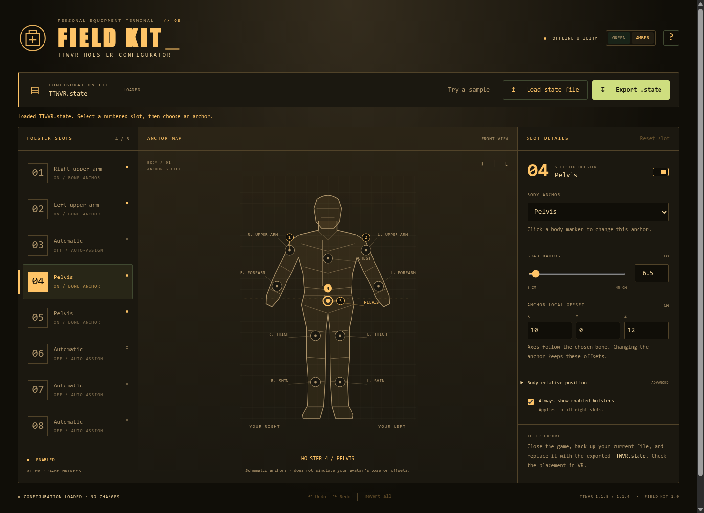

# TTWVR Holster Editor — Field Kit

An offline, Fallout-inspired editor for **TTWVR 1.1.5 / 1.1.6** holster settings.
Open one HTML file in a current browser on **Windows or Linux**. No install,
server, Python, Node, account or network connection is needed to use it.



## Open the tool

Download [index.html](index.html) using GitHub's **Download raw file** button,
then open that downloaded file in Edge, Chrome or Firefox. Keep the `.html`
extension. The file contains all scripts, styles and artwork.

1. **Load state file**: select your `TTWVR.state` file, or drop it onto the window.
2. Select a numbered holster. Click a body anchor or choose it from the list.
3. Set its enabled state, grab radius and anchor-local offset. Values in the
   interface are in **centimetres**. The file stores metres.
4. **Export .state** downloads a copy. With Fallout and the mod manager closed,
   back up the original and replace it with the downloaded `TTWVR.state`.
   Remove any browser-added suffix such as `(1)` from the filename.
5. Launch the game and check the placement in VR.

**Try a sample** demonstrates the controls. Load your own file to enable export.
The tool never overwrites game files directly.

## Find your configuration

TTWVR stores its configuration in New Vegas's `FalloutNV` Documents folder.

| System | Location |
|---|---|
| Windows | Your Documents folder → `My Games\FalloutNV\TTWVR.state` (Documents may be redirected to OneDrive) |
| Linux / Proton | Your VR prefix → `drive_c/users/steamuser/Documents/My Games/FalloutNV/TTWVR.state` |

This is separate from `TTWVR.ini` and your savegame. The editor requires the eight
position records and enabled/visibility flags written by the mod. If the holster
sections are missing, place/toggle a holster in VR and quit once to create them.

## Controls

- Eight slots matching the game's **1–8 hotkeys**; multiple holsters can use the
  same bone. Disabled slots retain their anchor and position.
- Ten explicit anchors: pelvis, chest, left/right upper arm, forearm, thigh and shin.
- **Automatic** removes an explicit bone binding. TTWVR chooses a nearby bone
  using the saved body-relative position when the avatar is ready.
- Grab radius from **5 to 45 cm**, the range enforced by 1.1.6.
- Local X/Y/Z offsets. Axes follow the bone; changing the anchor preserves the
  offsets. A new explicit binding starts at zero local offset.
- Advanced body-relative forward/right/up position, used by automatic anchoring.
- Global holster visibility, undo/redo, reset slot and revert all.
- Green and amber themes; keyboard-accessible anchor buttons; responsive layout.

The body map illustrates anchor choices. It does **not** simulate your avatar's
pose or preview the effect of offsets. Fine placement still needs a headset check.
This utility does not assign inventory items to hotkeys or fix holster drift.

## File preservation

Only holster records inside `[SavedSlots]` and `[SavedSlotsOn]` are edited.
Other sections, including height/arm calibration, Pip-Boy, magazine and pouch
settings, remain unchanged. An unedited export is byte-identical to its input.
UTF-8 and BOM-marked UTF-16 LE/BE, original line endings, comments and unknown
extension records are retained. Numbered list keys are made contiguous when
adding/removing a bone record; these keys are separate from the holster numbers.

Malformed, duplicate, incomplete or unsupported holster data is rejected.
Every export is parsed again and checked against the edited values. Loading an
invalid file leaves the current configuration open. No state file is uploaded or
stored in browser storage; only the optional color preference is remembered.

[File format and validation](FORMAT.md).

## Development

The generated `index.html` is committed so users can download it directly.
Edit `src/`, then rebuild using Python 3's standard library:

```sh
python3 tools/holster-editor/build.py
python3 tools/holster-editor/build.py --check
python3 tools/holster-editor/build.py --package TTWVR-Holster-Editor.zip
node --test tools/holster-editor/tests/state.test.cjs
```

The browser integration test uses Chromium's DevTools pipe and Node's built-in
modules. It creates a temporary browser profile and synthetic state files:

```sh
CHROME_BIN=/path/to/chrome node tools/holster-editor/tests/browser.cjs
```

Optionally set `SCREENSHOT_DIR` to keep interface screenshots. No npm install or
access to your existing browser profile is needed. On Windows, set `CHROME_BIN`
in your shell to a Chromium-based browser executable.

Tested in Chromium on Linux, plus the actual TTWVR 1.1.6 loader through Proton
with a simulated headset. Windows OS/browser execution and physical placement
have not been tested in this session.

## License

Original code and vector artwork: **GPL-3.0-only**, under the repository
[LICENSE](../../LICENSE). Independent community utility. No Fallout, TTWVR,
NVIDIA or AMD assets or binaries are bundled. The portable ZIP includes the
license; its HTML contains the application's JavaScript and CSS source.
