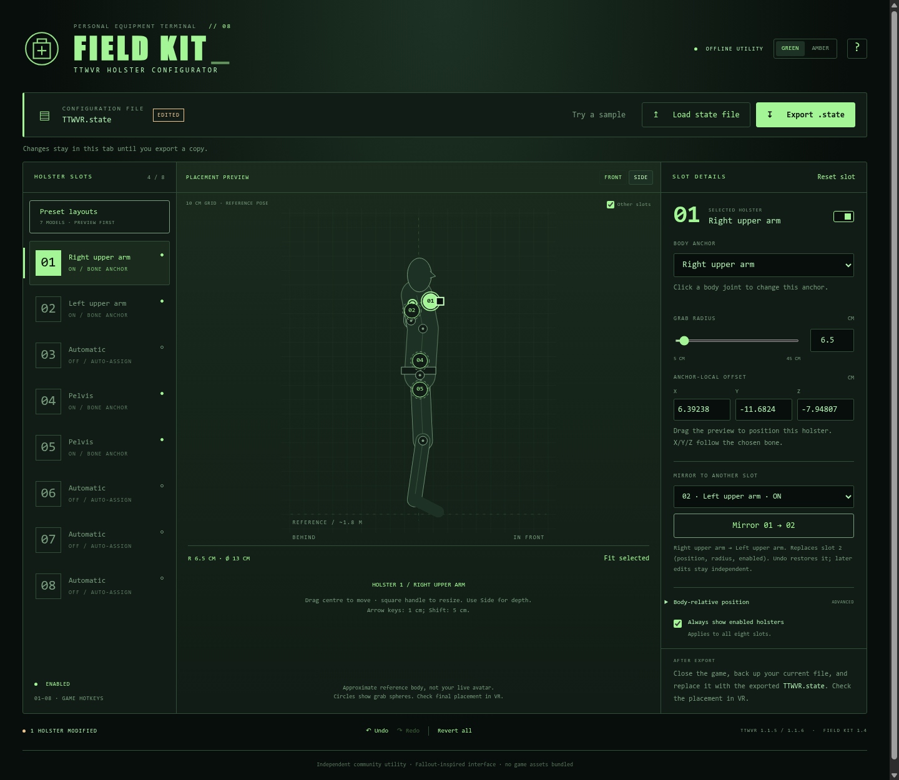

# TTWVR Holster Editor — Field Kit

An offline, Fallout-inspired editor for **TTWVR 1.1.5 / 1.1.6** holster settings.
Open one HTML file in a current browser on **Windows or Linux**. No install,
server, Python, Node, account or network connection is needed to use it.


## Open the tool

Download [index.html](index.html) using GitHub's **Download raw file** button,
then open that downloaded file in Edge, Chrome or Firefox. Keep the `.html`
extension. The file contains all scripts, styles and artwork.

1. **Load state file**: select your `TTWVR.state` file, or drop it onto the window.
2. Select a numbered holster. Click a body anchor or choose it from the list.
3. Drag the numbered centre to position it. Drag the square handle on the circle
   to resize its grab sphere. **Front** adjusts left/right and height; **Side**
   adjusts depth and height. Numeric controls use **centimetres**; the file stores metres.
4. To match the other side, choose a destination under **Mirror to another slot**
   and press **Mirror 01 → 02**, for example. The destination is replaced in one
   undoable action. Right upper arm becomes left upper arm with the matching offset.
5. **Export .state** downloads a copy. With Fallout and the mod manager closed,
   back up the original and replace it with the downloaded `TTWVR.state`.
   Remove any browser-added suffix such as `(1)` from the filename.
6. Launch the game and check the placement in VR.

**Try a sample** demonstrates the controls. Load your own file to enable export.
The tool never overwrites game files directly.

## Preset layouts — Field Kit 1.2

Open **Preset layouts** above the slot list. Select a profile to see its front
and side previews, then choose **Apply**. Browsing or closing the preview does
not change your layout; applying is one undoable edit.

| Profile | Enabled slots | Anchors and intended placement |
|---|---:|---|
| Front reach | 6 | Upper arms, forearms and upper thighs; forward grab points |
| Upper body | 6 | Upper arms, chest and pelvis; chest/belt targets offset in front |
| Torso front | 4 | Chest and pelvis only, with clearance in front of the torso |
| Arms only | 4 | Upper arms and forearms; no lower targets |
| Large targets | 4 | Upper arms and upper thighs, with larger 10.5 cm grab radii |
| Thigh kit | 4 | Two targets on the front of each thigh |
| Full kit | 8 | Front reach plus a second, lower pair on the thighs |

Both torso and limb anchors are available. Torso targets are offset forward so
reaching them does not require putting your hand inside the reference body.
You can choose whether odd-numbered slots are on your right or left and move
all preset targets **5 or 10 cm farther forward**. Each pair is mirrored using
the verified bone frames. Previews show radii and the smallest sphere-to-sphere
gap in the reference pose; side views label a mirrored pair together because
both occupy the same projected location.

Apply updates the chosen slots' anchors, local offsets, radii and enabled state.
Other slots are disabled while retaining their existing placements. All saved
body-relative fallback positions, global visibility, calibration and unrelated
state sections stay unchanged. The explicit anchors drive the placement; TTWVR
can refresh the fallback positions when it runs. Presets do not assign inventory
items to hotkeys.

These are practical **starting layouts**, not measured ergonomic optima. Their
reference positions and separation have been checked, but the current body pose,
calibration, clothing and wrist Pip-Boy can affect reach. Test the fit in VR and
adjust individual slots with the usual controls. The lower thigh pair takes a
longer reach. Export each finished layout to keep it as a separate profile.


## Export recovery for an already-open 1.1 tab

Field Kit **1.1.1** fixes `Export verification failed for a position value` after
some drag operations. The old exporter rounded a coordinate before checking it,
occasionally moving it across a game-float rounding boundary. The corrected
exporter retains the edited value and keeps verification enabled.

If your edits are still in the old tab, **do not reload it yet**:

1. Open the browser console **in the editor tab** (Chrome/Edge: Ctrl+Shift+J;
   Firefox: Ctrl+Shift+K).
2. Paste the contents of [recover-export.js](recover-export.js) and press Enter.
   It repairs that tab's export function in memory and requests a `TTWVR.state`
   download with your existing edits. It has no network access and does not
   write to the installed game. Only changed numbers are rounded to the game's
   float32 values for compatibility with the old serializer.
3. Once the download succeeds, open the updated editor and load that file.

The portable ZIP includes the same script as `Recover-Open-Tab.js`.

## Find your configuration

TTWVR stores its configuration in New Vegas's `FalloutNV` Documents folder.

| System | Location |
|---|---|
| Windows | Your Documents folder → `My Games\FalloutNV\TTWVR.state` (Documents may be redirected to OneDrive) |
| Linux / Proton | Your VR prefix → `drive_c/users/steamuser/Documents/My Games/FalloutNV/TTWVR.state` |

This is separate from `TTWVR.ini` and your savegame. The editor requires the eight
position records and enabled/visibility flags written by the mod. If the holster
sections are missing, place/toggle a holster in VR and quit once to create them.

## Controls

- Eight slots matching the game's **1–8 hotkeys**; multiple holsters can use the
  same bone. Disabled slots retain their anchor and position.
- Ten explicit anchors: pelvis, chest, left/right upper arm, forearm, thigh and shin.
- **Automatic** removes an explicit bone binding. TTWVR chooses a nearby bone
  using the saved body-relative position when the avatar is ready.
- Front and side orthographic previews, a **10 cm grid**, live grab spheres and
  radius/diameter readout. Numeric edits update the preview while typing.
- Drag the centre to move in the displayed plane; drag its square handle to resize.
  Arrow keys move 1 cm; Shift + arrows moves 5 cm. On the radius handle these keys
  change the radius. Escape cancels a drag; each completed drag is one undo step.
- **Other slots** shows/hides the remaining explicitly anchored holsters. Disabled
  slots use faded/dashed outlines. **Fit selected** recentres an off-screen holster;
  clicking Front or Side restores the whole-body view.
- Grab radius from **5 to 45 cm**, the range enforced by 1.1.6.
- **Mirror to another slot** swaps left/right anchors, mirrors the bone-local
  offset and saved fallback position, and copies radius and enabled state.
  Pelvis/chest mirror across the same central anchor. Automatic slots mirror
  their fallback position without adding a bone binding. Undo restores the whole
  destination. Slots remain independent after the copy.
- Local X/Y/Z offsets. Axes follow the bone; changing the anchor preserves the
  offsets. A new explicit binding starts at zero local offset.
- Advanced body-relative forward/right/up position, used by automatic anchoring.
- Global holster visibility, undo/redo, reset slot and revert all.
- Green and amber themes; keyboard-accessible anchor buttons; responsive layout.

The preview now shows the offset and radius at a consistent physical scale on an
**approximate reference body (~1.8 m)**. Bone frames were checked against the
skeleton supplied with TTWVR 1.1.6; no mesh assets are bundled. The state file
contains no current tracked pose, so this is not a live avatar or a guaranteed
fit for your calibration. Automatic anchors have no bone preview until you choose
an explicit anchor. Check final placement in the headset.


This utility does not assign inventory items to hotkeys or fix holster drift.

## File preservation

Only holster records inside `[SavedSlots]` and `[SavedSlotsOn]` are edited.
Other sections, including height/arm calibration, Pip-Boy, magazine and pouch
settings, remain unchanged. An unedited export is byte-identical to its input.
UTF-8 and BOM-marked UTF-16 LE/BE, original line endings, comments and unknown
extension records are retained. Numbered list keys are made contiguous when
adding/removing a bone record; these keys are separate from the holster numbers.

Malformed, duplicate, incomplete or unsupported holster data is rejected.
Every export is parsed again and checked against the edited values. Loading an
invalid file leaves the current configuration open. No state file is uploaded or
stored in browser storage; only the optional color preference is remembered.

[File format and validation](FORMAT.md).

## Development

The generated `index.html` is committed so users can download it directly.
Edit `src/`, then rebuild using Python 3's standard library:

```sh
python3 tools/holster-editor/build.py
python3 tools/holster-editor/build.py --check
python3 tools/holster-editor/build.py --package TTWVR-Holster-Editor.zip
node --test tools/holster-editor/tests/*.test.cjs
```

The browser integration test uses Chromium's DevTools pipe and Node's built-in
modules. It creates a temporary browser profile and synthetic state files:

```sh
CHROME_BIN=/path/to/chrome node tools/holster-editor/tests/browser.cjs
```

Optionally set `SCREENSHOT_DIR` to keep interface screenshots. No npm install or
access to your existing browser profile is needed. On Windows, set `CHROME_BIN`
in your shell to a Chromium-based browser executable.

Tested in Chromium on Linux, plus the actual TTWVR 1.1.6 loader through Proton
with a simulated headset. Windows OS/browser execution and physical placement
have not been tested in this session.

## License

Original code and vector artwork: **GPL-3.0-only**, under the repository
[LICENSE](../../LICENSE). Independent community utility. No Fallout, TTWVR,
NVIDIA or AMD assets or binaries are bundled. The portable ZIP includes the
license; its HTML contains the application's JavaScript and CSS source.
